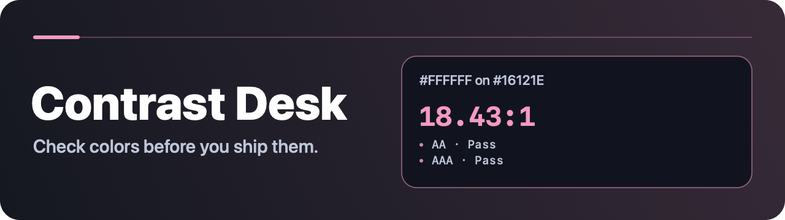

<p align="center">
  
</p>

# Contrast Desk

Check a text and background color, compare common accessibility contrast thresholds, and see whether black or white text offers more contrast on that background.

## At a glance

| Task | How |
| --- | --- |
| **Check a color pair** | Pass text and background hex colors. |
| **Enforce a threshold** | Use `--require aa` or choose one of the large-text or AAA thresholds. |
| **Pick a text color** | See whether black or white gives the higher ratio. |

## Quick start

```sh
python3 contrast_desk.py '#fff' '#16121e' --require aa
python3 contrast_desk.py f090bd 211a2b
```

Requires Python 3.9+. The tool compares two opaque sRGB colors. Use `--require aa`, `aa-large`, `aaa`, or `aaa-large` to return an exit status of 1 when a pair falls short. A color-pair check covers contrast only. [MIT](LICENSE)
